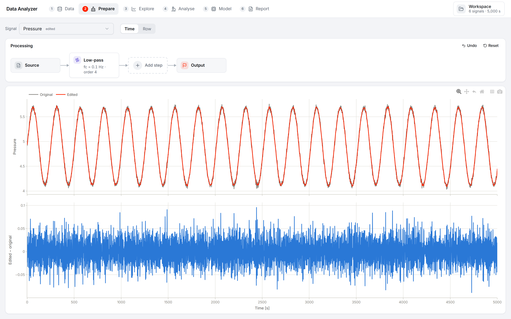
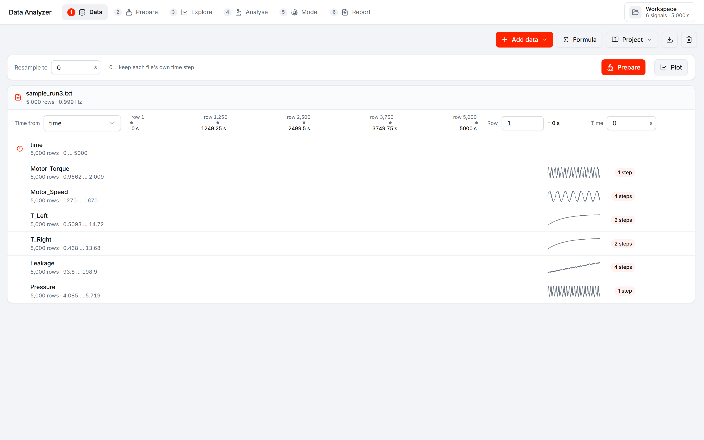
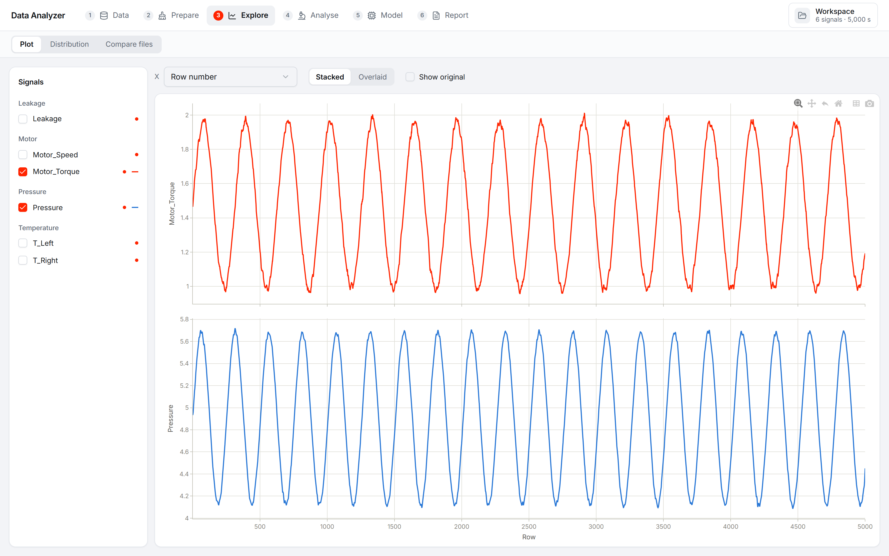
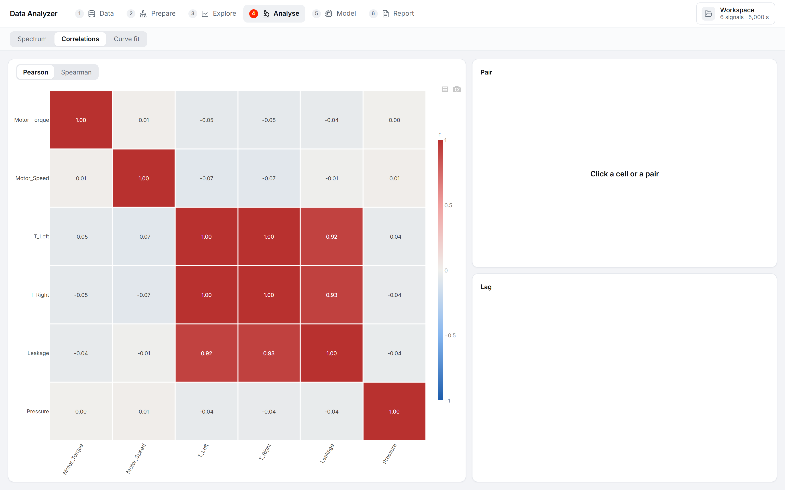

# Data Analyzer

A local desktop app for exploring numeric measurement data, cleaning it step by step and fitting models. Built with Tauri, Rust, React and Plotly. Everything runs on your computer.



**Data → Prepare → Explore → Analyse → Model → Report**

- **Data**: CSV, text, Excel, Parquet, MAT, HDF5 and TDMS files in one workspace. Each file keeps its own time base: take the time from a column or a fixed step per row, check rows against time, and line files up.
- **Prepare**: process a signal as a row of blocks (clean, filter, adjust). Click a block to see its input and output, change it, move it or delete it.
- **Explore**: plots, distributions and file comparison.
- **Analyse**: spectrum, correlations and curve fitting.
- **Model**: identify, store, simulate and validate state-space models.
- **Report**: one HTML or PDF file with tables, charts and the processing diagram of each signal.







See [the guide](docs/analysis-workspaces.md) for details.

## Run

Install Node.js, Rust and the [Tauri prerequisites](https://v2.tauri.app/start/prerequisites/) for your system. On Windows, Tauri needs the Microsoft C++ build tools and WebView2.

```sh
npm ci
npm run app:dev
```

Build the installer with `npm run app:build`. A Python server is not needed.

## Verify

```sh
npm run build
node --test tools/analysis.test.ts
cargo test --manifest-path src-tauri/Cargo.toml
```

The Rust tests cover import, processing, spectra, correlation, fitting, system identification and validation. Numerical reference fixtures are in `src-tauri/tests/fixtures`.
