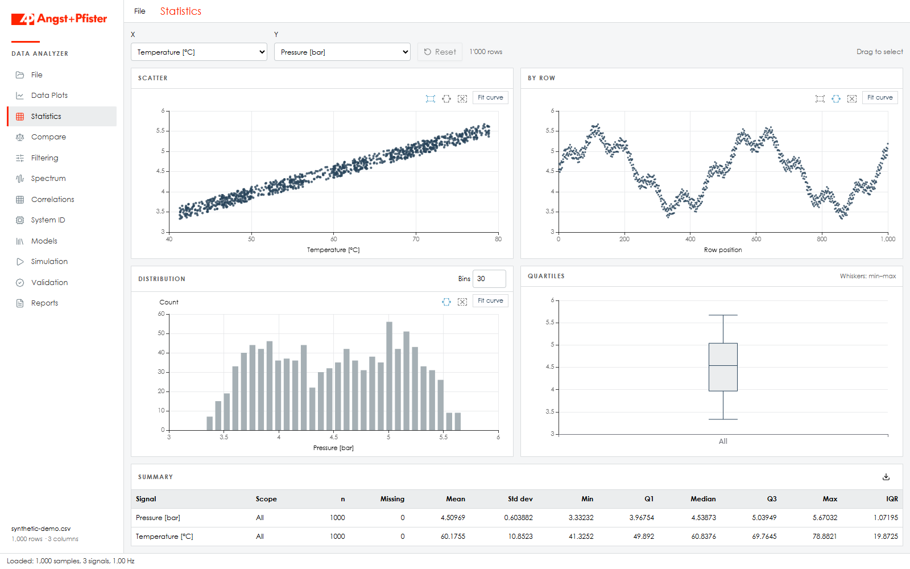

# Data Analyzer

A local desktop workspace for exploring numeric datasets, comparing measurements and fitting models. Built with Tauri, Rust, React and ECharts.



*Statistics workspace with synthetic example data.*

- Import CSV, delimited text and Excel files, with preview and format overrides.
- Plot columns against row positions, time or another numeric column.
- Fit curves from numeric charts using built-in or custom equations, coefficient bounds, exclusions, residuals and uncertainty estimates.
- Explore linked scatter plots, distributions, row plots and summary statistics.
- Compare files, apply filters, inspect spectra and correlations, identify state-space models, simulate and validate them.
- Export reports, fit results and statistics.

See [the analysis guide](docs/analysis-workspaces.md) for fitting and linked selections.

## Run

Install Node.js, Rust and the [Tauri prerequisites](https://v2.tauri.app/start/prerequisites/) for your operating system. On Windows, Tauri requires the Microsoft C++ build tools and WebView2.

```sh
npm ci
npm run app:dev
```

Create a desktop build with `npm run app:build`. The application processes data locally; a Python server is not required.

## Verify

```sh
npm run build
node --test tools/analysis.test.ts
cargo test --manifest-path src-tauri/Cargo.toml
```

The Rust tests cover import, filtering, spectra, correlation, fitting, system identification and validation. Numerical parity fixtures are included under `src-tauri/tests/fixtures`.
