# Data Analyzer

A local desktop app for exploring numeric measurement data, cleaning it step by step and fitting models. Built with Tauri, Rust, React and Plotly. Everything runs on your computer.

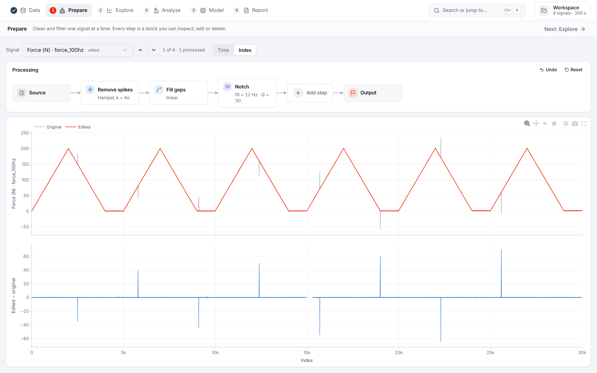

**Data → Prepare → Explore → Analyse → Model → Report**

- **Data**: CSV, text, Excel, Parquet, MAT, HDF5 and TDMS files in one workspace. Each file keeps its own time base: take the time from a column or a fixed step per row, check rows against time, and line files up.
- **Prepare**: process a signal as a row of blocks (clean, filter, adjust). Click a block to see its input and output, change it, move it or delete it.
- **Explore**: plots, distributions and file comparison.
- **Units**: every signal shows its unit; set, fix or convert units (mm → µm, °C → °F, bar → psi) for one signal or all at once.
- **Analyse**: spectrum, spectrogram and order analysis, frequency response (Bode and coherence), peaks, valleys and limit checks with every parameter tunable, cycles cut at trigger events, correlations and curve fitting. Extracted values export as CSV.
- **Model**: identify, store, simulate and validate state-space models.
- **Report**: a **Results** table of scalar values (measured, or sent from Cycles, Frequency response, Order analysis and Curve fit), and one HTML or PDF file with tables, charts, the results and the processing diagram of each signal.

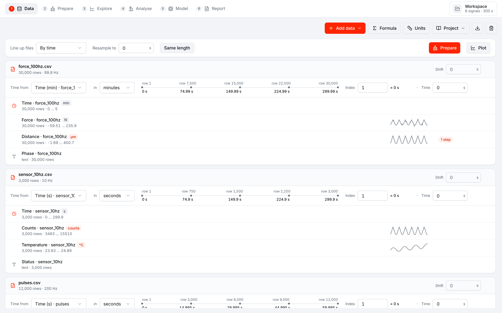

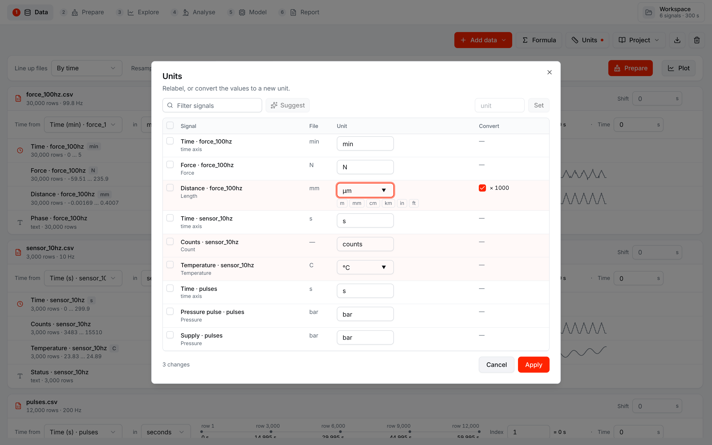

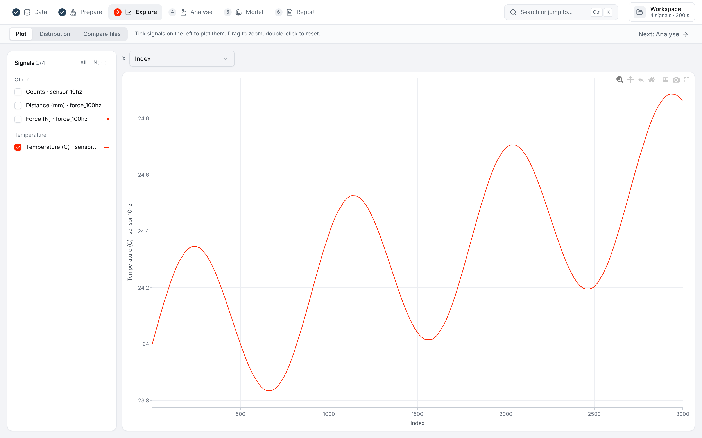

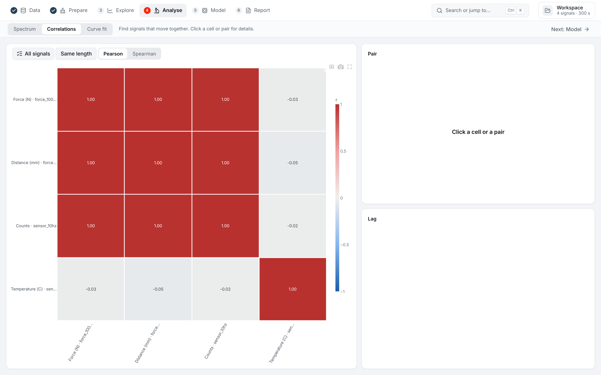

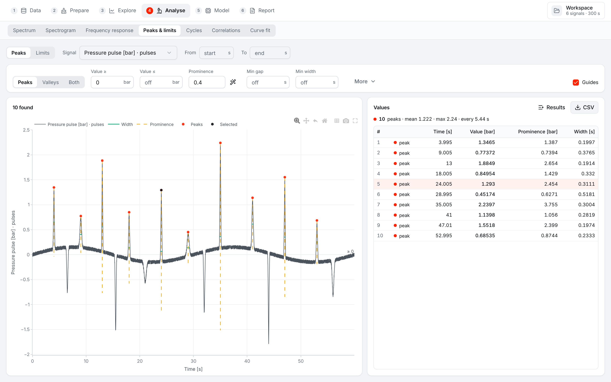

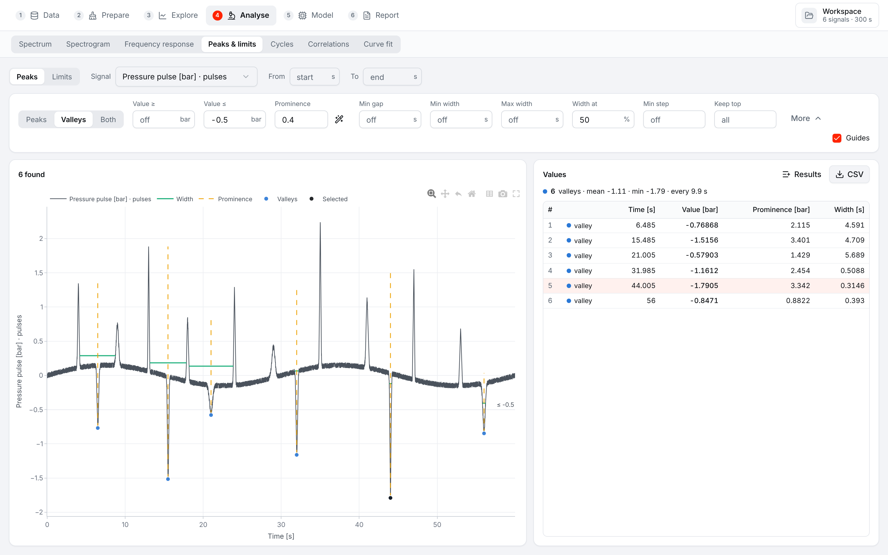

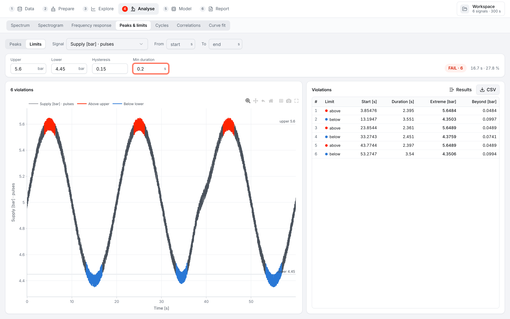

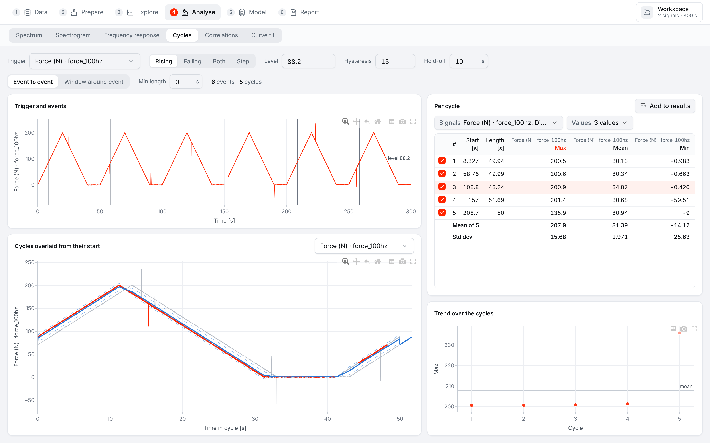

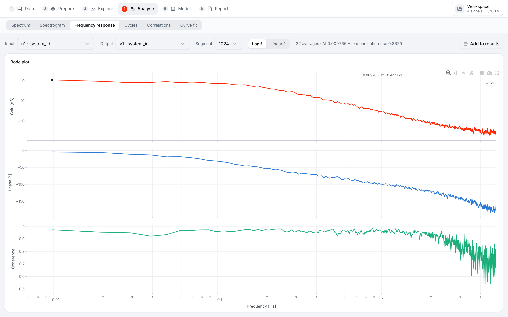

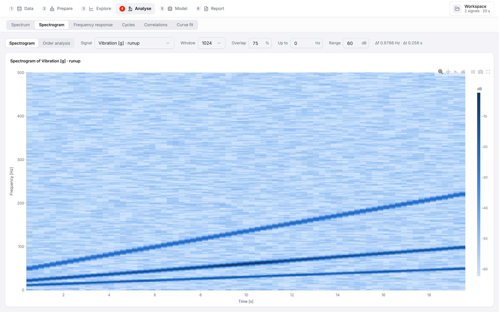

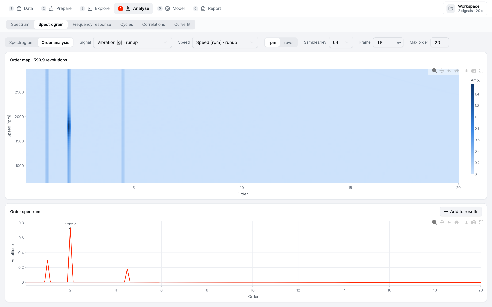

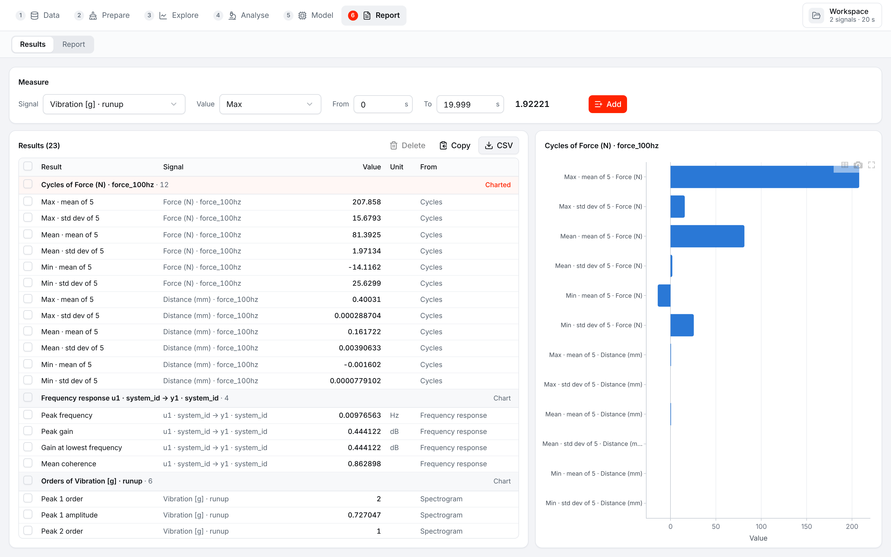

See [the guide](docs/analysis-workspaces.md) for details.

## Run

Install Node.js, Rust and the [Tauri prerequisites](https://v2.tauri.app/start/prerequisites/) for your system. On Windows, Tauri needs the Microsoft C++ build tools and WebView2.

```sh
npm ci
npm run app:dev
```

Build the installer with `npm run app:build`. A Python server is not needed.

## Verify

```sh
npm run build
node --test tools/*.test.ts
cargo test --manifest-path src-tauri/Cargo.toml
```

The TypeScript tests cover the spectrogram, frequency response, order analysis, event detection and measurements against signals with known answers. The Rust tests cover import, processing, spectra, correlation, fitting, system identification and validation. Numerical reference fixtures are in `src-tauri/tests/fixtures`.

`samples/pulses.csv` has positive and negative pulses and a slowly swinging supply pressure for trying peaks, valleys and limits. `samples/runup.csv` is a 20 s run-up (600 → 3000 rpm) with orders 1, 2 and 4.5 for trying the spectrogram and order analysis. `samples/test-suite` holds synthetic files with known contents (spikes, gaps, tones, model coefficients); the tests check the results against its `manifest.json`. For a stress test with million-row files, see [samples/test-suite/README.md](samples/test-suite/README.md).
